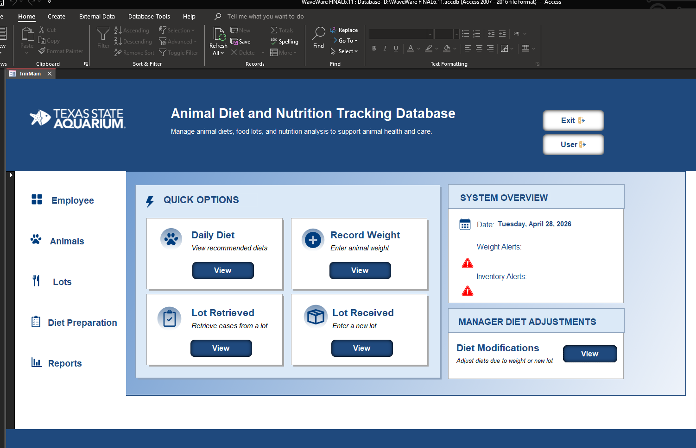
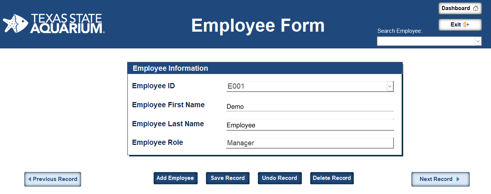
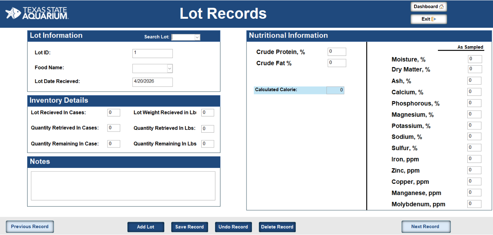

# WaveWare Access Database Demo

A representative Microsoft Access portfolio project based on Texas State Aquarium requirements, connecting animal diet records, food-lot inventory, weight tracking and reporting.

**Near-final demo — not the actual final submission, a current aquarium system, official aquarium documentation, or animal-care guidance.**

[Project overview](#project-overview) · [Documentation](#project-documentation--user-guide) · [Screenshots](#screenshots) · [Open the demo](#open-the-demo) · [Privacy & limitations](#privacy--limitations) · [Validation](#validation)

## Start Here

| Want to… | Resource |
| --- | --- |
| Understand the design without Access | [Read the 27-page Project Documentation & User Guide](docs/WaveWare-Project-Documentation-Public.pdf) |
| Explore the editable application | [Download the Access database](https://github.com/Saner108/waveware-access-demo/releases/download/waveware-near-final-demo-2026-10-28/WaveWare_NearFinal_Employee_Demo.accdb) · [Release notes](https://github.com/Saner108/waveware-access-demo/releases/tag/waveware-near-final-demo-2026-10-28) |
| Preview the interface | [View screenshots](#screenshots) |
| Verify downloaded files | [Database checksum](CHECKSUMS.sha256) · [PDF and preview checksums](docs/CHECKSUMS.sha256) |

The database is a release attachment, not a file stored in the repository. The PDF and preview images are available directly in this repository; their checksum paths are relative to the repository root.

## Project Overview

WaveWare illustrates how relational records, saved queries, forms, reports and macros can support a connected operational workflow. The source guide describes the following areas:

| Area | Documented scope |
| --- | --- |
| Animal records & diets | Animal details, daily diet entries, weight records and diet-change forms |
| Food & inventory | Food items, lot receipt, nutritional inputs, retrieval and remaining quantities |
| Employee & manager workflows | Employee records, menu navigation and manager diet-adjustment screens |
| Reporting & alerts | Animal, food and stock reports; weight and diet-adjustment alert screens |

These descriptions summarize the documented design, not proof that every calculation, alert or workflow works correctly in the downloadable demo. The portfolio focus is database design, systems analysis, interface organization and user documentation.

## Project Documentation & User Guide

The [public PDF](docs/WaveWare-Project-Documentation-Public.pdf) adapts the supplied **April 21, 2026** report for portfolio sharing. The public edition is dated **October 29, 2026**.

| PDF pages | What to review |
| --- | --- |
| 2 | Public-edition scope, privacy changes and verification limits |
| 3–5 | Corrected, clickable contents |
| 6–11 | Executive summary, introduction and system analysis/design |
| 12–26 | Dashboard, animal/employee records, food lots, diet forms, alerts and reports |
| 27 | Conclusion and proposed follow-up checks |

The edition adds numbered footers, **31 contents links and 11 bookmarks**, replaces the employee name visible in a screenshot, and qualifies claims about intended benefits. The original supplied PDF was not modified or uploaded.

**Version note:** the screenshots and instructions describe the source project version and may differ from the separately published near-final database. Read page 2 before following the guide.

## Screenshots

These are static previews, not new native Access test captures.

### Main menu

### Employee records

The guide preview uses generic **Demo** and **Employee** name fields. The identifier and manager role remain visible; these labels do not establish a mapping to names in the separate release database.

### Lot inventory

## Open the Demo

**Requirements:** Microsoft Access on Windows. The source guide describes Access 365; compatibility with other Access versions has not been established. No website, server or package installation is required to read the PDF and previews.

1. Download the `.accdb` file from the [release](https://github.com/Saner108/waveware-access-demo/releases/tag/waveware-near-final-demo-2026-10-28).
2. Verify the download against [`CHECKSUMS.sha256`](CHECKSUMS.sha256), then keep a clean copy and open a working copy.
3. Enter the file-opening code below when prompted.
4. Review saved code and macros before enabling active content. Only enable content you trust.
5. Start at the main menu and use the guide to explore records, lots, diets and reports. Changes may be saved to your working copy; guide steps may differ from the release.

### Intentionally public demo codes

| Prompt | Code |
| --- | --- |
| Open the database file | `2710` |
| Manager diet-adjustment menu | `1234` |

These codes provide **no confidentiality or production security** and must not be reused for a real deployment.

## Privacy & Limitations

### Database sharing changes

Four employee names were replaced with `Demo Employee01` through `Demo Employee04`. Employee IDs and manager/staff roles were preserved. Existing tables, fields, indexes, relationships, queries, forms, reports, macros and database settings were preserved.

Other aquarium records were retained unchanged with the project owner's explicit approval. The original source database was not modified. Adding this guide did not alter or replace the database release.

### Documentation sharing changes

The screenshot employee first and last name were permanently replaced with generic demo text. The public PDF was saved as a new, non-incremental file with unused name-bearing image data discarded. The guide's contents and overview/design/conclusion wording were revised for public sharing.

Other project records, including animal names, dates and numeric values, remain visible. **Neither the database nor the guide is fully anonymized or fully synthetic.**

### What is not claimed

- This is not a current aquarium system, the actual final submission, or official aquarium documentation.
- Native Access navigation, forms, queries, calculations, macros and reports have not been re-tested after the database's public-sharing edit.
- The project does not establish measured efficiency gains, clinical accuracy, secure access controls, scalability or production readiness.
- Do not use the database, guide or screenshots for animal-care or feeding decisions.

## Validation

### Previously recorded database-artifact checks

These are checks recorded for the existing release, **not tests re-run during the documentation or README updates**:

- Compared all 25 user tables and 69 records with the source, allowing only eight employee-name fields to change.
- Compared schema definitions and saved Access object storage separately.
- Scanned decoded database pages, including unused content, for the original first and last names in their original, lowercase and uppercase forms.
- Verified the file-opening password and that the saved manager macro still checks `1234`.
- Recorded the release attachment's SHA-256 digest in [`CHECKSUMS.sha256`](CHECKSUMS.sha256).

### Public documentation checks — October 29, 2026

- Rendered and visually reviewed all 27 pages; checked 31 contents links and 11 bookmarks against their destinations.
- Reviewed source screenshots and performed 49 local OCR scans across public embedded images, rendered pages and the two preview images. The removed employee first and last name were not found in those scans or extracted PDF text.
- Confirmed the original name-bearing image stream was absent from the saved PDF; checked generic metadata and absence of embedded attachments, forms and JavaScript.
- Checked PDF/preview SHA-256 hashes, local README links and GitHub Markdown rendering. Verified the published files remotely and compared the downloaded public PDF byte-for-byte.
- Confirmed the original supplied PDF and existing database release were unchanged.

These are scoped publication checks, **not a guarantee of complete anonymization, native Access behavior or animal-care suitability**. No database edits, native Access workflow tests, calculation validation or website deployment were performed for the documentation update.
